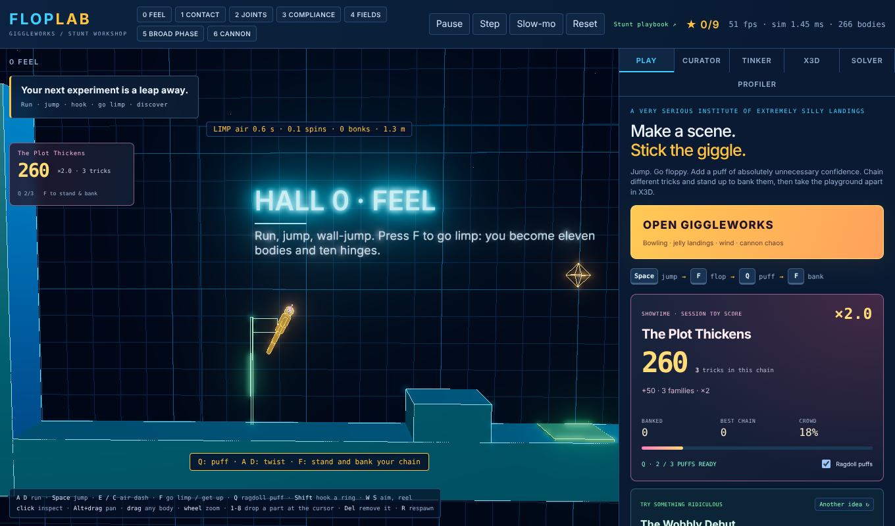

# x3d.gamelab · Flop Lab

**Separate experiment: [CHASM · Wingsuit Observatory](cavern/)** — a 3D wingsuit ragdoll descent through natural and virtual caverns, with air-relative flight physics, live wind controls, telemetry and an X3D snapshot exporter. **2.0** adds an arcade layer (columns, thermals, embers, chains, focus time, ghost) and a new FX layer; frozen builds at [cavern/releases/](cavern/releases/). See [launch and model notes](cavern/README.md) and [ARCADE.md](cavern/docs/ARCADE.md).

**Play: https://hagopjay.github.io/x3d.gamelab/** (frozen builds under `releases/<version>/`, never overwritten)



A hybrid X3D gameplay concept: a 2.5D ragdoll stunt platformer, an X3D 4.0 level you can edit live, and a physics zoo, all driven by one custom compliant-position (XPBD-style) solver written in JavaScript and drawn by a three.js bridge. The level is one X3D file (255 RigidBody, 182 joints, 30 ProximitySensor regions); the game, the editor and the validators read the same bytes.

| Where | What |
|---|---|
| `releases/0.3.0/` | Frozen, self-contained build served on Pages (Giggleworks Showtime) |
| `index.html` | Current build (rebuilt by `node build.mjs`, byte-reproducible) |
| `src/` | Solver (`core.js`), level, recipes, game, expeditions, showtime, view, X3D codec |
| `level/*.x3d` | Five authored worlds, X3D 4.0 |
| `docs/` | Field guide, Stunt Playbook, X3D contract, audits, `media/` screenshots |
| `vendor/` | Pinned three 0.187.0 runtime and the x3d_mcp validation subset (hashes in `ORIGIN.json`) |
| `test/`, `tools/` | 12 Node suites, browser harness, `test/pages-smoke.mjs`, validators, `tools/freeze_release.mjs` |

Controls: Space jump, F go limp / recover and bank, Q ragdoll puff, E air dash, Shift grapple. Phone layout has touch controls.

**Checked at integration (17 Nov 2026, Node 22.23.4, headless Chromium 153 on SwiftShader, one cloud machine; not a second reader's numbers):** `npm test` exits 0 with 154 PASS lines; `node build.mjs` reproduces `index.html` byte for byte; `npm run test:pages` loads the page and the frozen release from a `/x3d.gamelab/` sub-path with zero console errors and zero 4xx, stepping 255 bodies and 182 joints; 390 px phone width has no horizontal scroll. Not shown: Firefox/WebKit, a real GPU, a human player, gamepad hardware. Earlier build-session evidence is in `VALIDATION.md` and `receipts/`.

Part of the x3d.io project; the portable lessons from this build are proposed upstream to x3d.loom.

---

# Flop Lab · Giggleworks Showtime

A local physics playground with six challenges, five worlds, a crash-test hero,
an editable X3D source model and an inspectable compliant position solver. This
edition extends the supplied fold-back source; its original seven-hall museum
and physical algorithms remain available.

## Make a scene

Choose **OPEN GIGGLEWORKS** for the new six-station Carnival. Jump with Space,
press F while rising, Q to puff while limp, then F again to recover and bank the
chain. Three directional puffs reload on each new flop. Recovery can bank
midair; this is intentionally an open arcade toy, with no shared leaderboard.

Showtime adds seven open spotlight prompts, nine souvenir stickers, variety
multipliers, a crowd meter, comic captions and bounded confetti. Party hat,
pilot goggles and noodle antenna are cosmetics over the same collision model.
Sound starts off: enable it in **Sound, smiles & comfort** or press M. Reduced
motion honors the system preference and suppresses bursts/shake while retaining
text. Quiet play keeps the same mechanics and information.

Actual puff use makes an active legacy Expedition challenge practice. Showtime
points, the original stunt-card score and Expedition medals have distinct
meanings. Session show totals/stickers survive course rebuilds; pending chains
do not. Reloading the page clears that session. Read the self-contained
[Stunt Playbook](docs/Stunt-Playbook.html) for deeper gameplay, mathematics,
experiments and future authoring directions.

## Play immediately

Unzip the complete release and run `run.bat` on Windows or `bash run.sh` in
WSL/Linux/macOS. Alternatively run `python3 serve.py --open`. The page opens at
**http://127.0.0.1:8840/**. Python 3.10+ is sufficient for the server; keep the
terminal running. The release bundles Three 0.187.0 and its bloom modules.
Normal local gameplay needs no npm install, CDN, model key or hosted service.

Without usable WebGL, a labeled Canvas2D view runs the same simulation with
debug overlays. It is an alternate presentation, not a pixel-parity claim.
Choose **First Flight**: jump, then press F while still rising. The authored
goal is 0.8 seconds of ragdoll airtime. Non-free challenge starts reset the
physical world from the current source/settings while preserving campaign
records within that course session. Free play preserves the physical world.

| Action | Input |
|---|---|
| Run / jump | A D or arrows / Space |
| One air dash; land to recharge | E or C, with direction keys |
| Go limp / recover and bank / ragdoll puff | F / F / Q |
| Hook / reel / release | Hold Shift / W S / Space |
| Enter cannon / aim / power / fire | W / W S / A D / Space |
| Inspect / drag / pan / zoom | Click / drag / Alt+drag / wheel |
| Pause / fixed step / respawn | P / full stop / R |
| Drop source prefab / remove | 1–8 at cursor / Delete |

Touch controls are included. Gamepad input is opt-in and requires course focus;
gamepad hardware was not available for verification. Editing, tuning,
teleporting or dragging makes an attempt practice. Medals are authored local
game goals, not verified leaderboards or scientific acceptance limits.

## Play, forge, investigate

- Six expeditions: First Flight, Contact Sprint, Constellation Run, Air Mail,
  Wind Rider and Cannon Post. Goals distinguish causal events from stale stunts,
  unrelated hits, pre-fan peaks, deaths and expired attempts.
- Five worlds: Seven Halls, Grapple Skyline, Cascade Foundry, Tidal
  Conservatory and Giggleworks Carnival. Seeded recipes produce editable, exportable source levels.
- Tinker: selected-prefab JSON editing, framing, deletion and undo. Typed,
  finite and expanded-resource validation precedes model replacement.
- Camera: follow/free/overview, quality/shake, contacts/joints/COM/velocity/
  broad-phase overlays, and bounded presentation ghosts.
- X3D: edit/apply/export the supported 4.0 slice; authored examples are in `level/`.
- Solver: inspect the actual substep code and deliberate break presets. A
  throwing kernel returns to stock. Custom solver code runs in the page's
  trust context; it is not a sandbox.
- Profiler: CPU time per fixed tick, CPU render-submission time, available
  draw statistics, energy and a pose fingerprint. Scrubbing reviews poses;
  returning live restores retained live state, without claiming past
  controller/RNG state is a complete checkpoint.
- Local lab partner: built-in commands add parts, explain scores and sweep
  parameters. An optional host-curator adapter remains in source; this release
  called no model service and claims no verified hosted model identity.

Read [the field guide](docs/Floplab-Field-Guide.html) for experiments, mathematics
and future directions, and [the X3D contract](docs/X3D-CONTRACT.md) before imports.

## X3D's role

The retained model uses RigidBodyCollection, RigidBody, CollidableShape, joints
and ProximitySensor nodes. Custom `flop` metadata retains prefabs, compliance,
2D collision rules and game regions. The same data drives the custom solver
and Three/Canvas views, so source edits and independent validation act on files.

This is a declared bridge subset. A Cylinder approximates the lab's pill;
BallJoint plus metadata carries custom springs/ropes. Another X3D consumer
does not automatically implement this solver or reproduce its trajectories.
A level export is not a live savegame. Local import policy is separate from
the actual pinned XSD and implemented semantic checks.

## Develop and verify

Node 22+ is recommended; this release was checked with Node 24.22.1.

```sh
npm ci --ignore-scripts
npm run vendor
npm run build
npm test
npm run export:levels
python3 -m pip install -r tools/requirements-validation.txt
python3 test/new-controls.validator.py
python3 tools/validate_levels.py --output receipts/showtime-x3d.json
node tools/check_release.mjs
```

Three's unmodified dependency closure/license is inventoried in
`vendor/three/ORIGIN.json`. MCP source/schemas/license are pinned to
`b5c9956917714747fe1d034c729612e99b0f09c9`. The optional Python adapter has its
own explicit 2 MiB file budget. Linkedom is a development-only XML DOM test
dependency; its checks do not substitute for native browser observations.

`VALIDATION.md` records fresh results. Historical `receipts/crosshost.json`,
`math-sweep.json`, `gates.json` and the original run record remain source
history, not fresh evidence for this changed application. The previous Expedition reports use `upgrade-*`; current full-release checks
use `showtime-*`. `new-controls.*` records the separately named control runs. No formal Loom release receipt is issued.
The inherited `npm run test:browser` harness remains for an independently
equipped machine; it was not executed here. Live checks used browser controls.

## Fold-back and publication

See [STUNT-FOLDBACK.md](docs/STUNT-FOLDBACK.md), [SHOWTIME-AUDIT.md](docs/SHOWTIME-AUDIT.md), [FOLDBACK.md](docs/FOLDBACK.md), [UPGRADE-FINDINGS.md](docs/UPGRADE-FINDINGS.md)
and the parent physics playbook. The delivery includes named-base patches and
a complete PR draft. No remote repository was changed: GitHub publication was
unavailable in this workspace.
