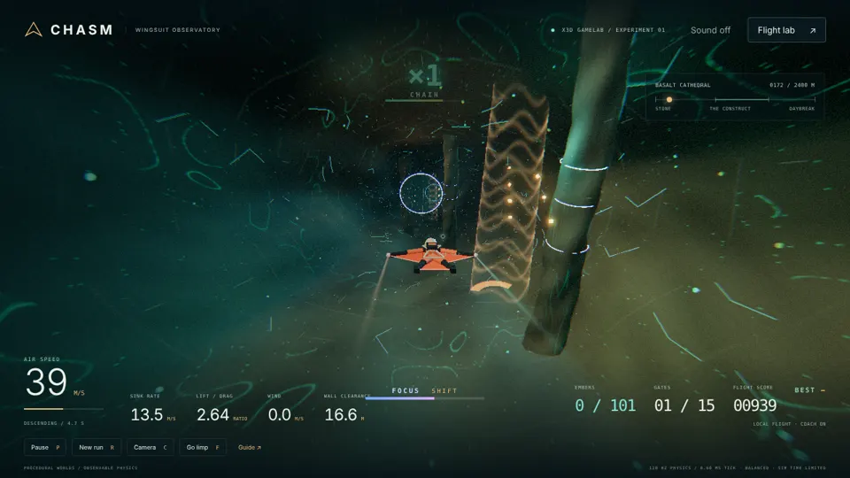
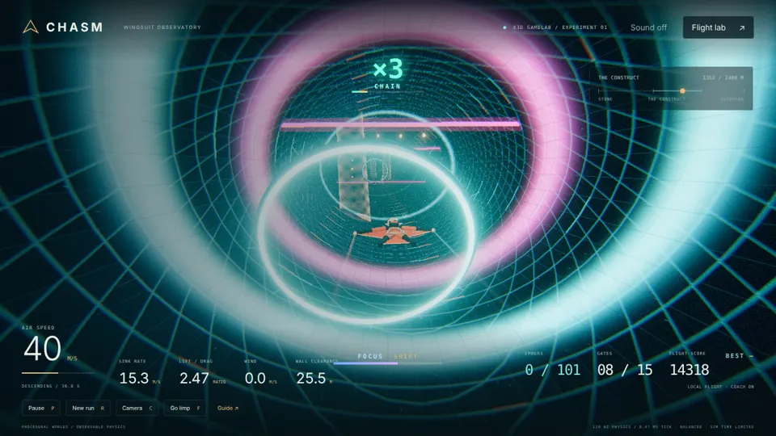
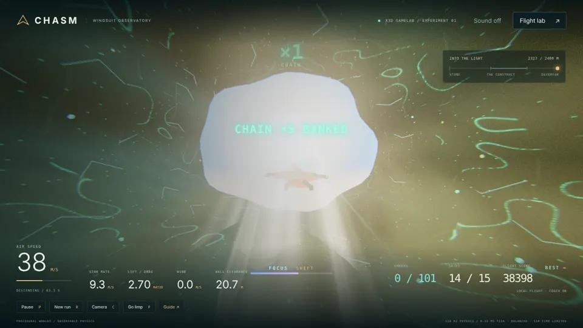

# CHASM 2.0 · Arcade layer

2.0 keeps the 1.0 flight model byte-for-byte when `params.arcade` is false (the
1.0 tests still pass unchanged) and adds a prescribed game world on top when it
is true (the default in the page). Nothing in the layer adds thrust: columns are
colliders, thermals are wind, embers are score.

| Release | Path | What it is |
|---|---|---|
| 1.0.0 | `cavern/releases/1.0.0/` | The delivered standalone, frozen (md5 3d102c31…, 3,064,172 B) |
| 2.0.0 | `cavern/releases/2.0.0/` | Frozen standalone of this layer (3,122,688 B, 18 embedded modules, 0 runtime requests) |
| live | `cavern/` | Source edition; tracks the newest release |

  

## World (all deterministic, `src/physics.js`)

| Element | Count | Rule | Collides | Scores |
|---|---|---|---|---|
| Rock columns | 13 (3 mid-passage) | z every 58 m, ≥30 m from any gate plane, natural zones only; r 2.0–3.6 m | yes, exact capsule SDF combined with the wall field (`arcadeBoundary`) | near miss "COLUMN SHAVE" |
| Light-bars | 8 | construct zone (905–1695 m); 10.5–12.5 m below or 14.5–17.5 m above the centreline; r 1.1 m | yes, same capsule pipeline | near miss "BEAM DODGE" |
| Thermals | 6 at z 260, 560, 1240, 1520, 1960, 2200 | vertical wind `w·exp(-(dx²+dz²)/R²)·(1+0.2 sin(1.3t+i))`, R 7.5 m, w 10.3–12.5 m/s | no | 0, but the lift lets you climb back to risky lines |
| Embers | 101 | beside columns, at bars, stacked in thermals, near walls; pickup radius 2.8 m from the COM; once each | no | 150 × chain |

## Scoring

| Feat | Base | Through chain? |
|---|---|---|
| Gate | 500–1000 by centring error | yes |
| Ember | 150 | yes |
| Close encounter (0.2–2.5 m) | 100 | yes |
| Skim (continuous, 0.15–3 m from rock) | (3 − clearance) × 90 per s | multiplied by the live chain |
| Finish | 2000 + 60 × (80 − time s) | no |
| Impact > 2 m/s | −8 × speed | **breaks the chain** |

Chain: every gate, ember and close encounter adds a link; multiplier = 1 + ⌊links / 3⌋, capped at ×8; the chain banks after 5 s with no new feat.

## Focus (bullet time)

Hold **Shift** / **E** / gamepad **A** (or the FOCUS touch button). The page feeds
the fixed 120 Hz clock `dt × 0.32` while the meter lasts (drain 0.32 per real
second). Refills: gate +0.25, ember +0.12, close encounter +0.06, skimming
+0.05/s, idle +0.012/s. The simulation itself is unchanged: same fixed ticks,
same determinism; only wall-clock-to-sim-time mapping slows.

## Medals and ghost

Medal lines were set against the arcade route coach, which never chases embers:

| Source | Gates | Impacts | Time | Score |
|---|---|---|---|---|
| 1.0 coach (arcade off) | 7 / 15 | 0 | 64.4 s | 6,961 |
| 2.0 coach (arcade on, gate-seeking, column-dodging) | 14 / 15 | 0 | 65.3 s | 41,280 |

Bronze = finish, Silver ≥ 45,000 (beat the coach), Gold ≥ 62,000. Numbers from
`node` v22.23.5 on the cloud runner, `FlightSim` stepped at 1/120 s with no input.
The best non-experiment run is stored locally (`chasm.best.v2`, try/catch, private
windows simply forget it) with a 10 Hz path; the next run shows it as a violet ghost.

## Controls added

| Input | Action |
|---|---|
| Shift / E / pad A / RT | Focus |
| Pad left stick | Bank + pitch (push = dive) |
| Pad B / Y / Start | Limp / camera / start or pause |
| Flight lab → Arcade world | Toggle the layer (marks the run as an experiment) |

## Evidence

| Gate | Result | Instrument |
|---|---|---|
| `node --test cavern/test/*.test.mjs` | 23/23 (16 from 1.0 unchanged + 7 arcade) | Node v22.23.5 |
| `npm test` (Flop Lab + cavern) | all PASS | Node v22.23.5 |
| Flop Lab `node build.mjs` reproducible | byte-identical `index.html` | git diff |
| `tools/validate_levels.py` on `CHASM-snapshot.x3d` + `CHASM-arcade-snapshot.x3d` | 2/2 PASS, 2/2 negative controls caught | pinned x3d_mcp b5c9956 (x3d-4.0 XSD + semantic), report `x3d-validation-2.0.json` |
| `cavern/test/browser.py` (1.0 harness) on 2.0 | 20/20 | Chromium 153.0.8010.12, SwiftShader, report `browser-validation-2.0.json` |
| `cavern/test/arcade-browser.mjs` | 18/18 across live, releases 2.0.0 + 1.0.0 (Pages subpath) and 2.0.0 over file:// | Chromium 153.0.8010.12, SwiftShader, report `arcade-browser-2.0.json` |

Draw calls rose from 88–91 (1.0, chase, balanced) to 116–141 (2.0), triangles
from ~31k to 33–56k; source `renderer.info` under SwiftShader. These are counts,
not GPU timings. No frame rate is claimed.
